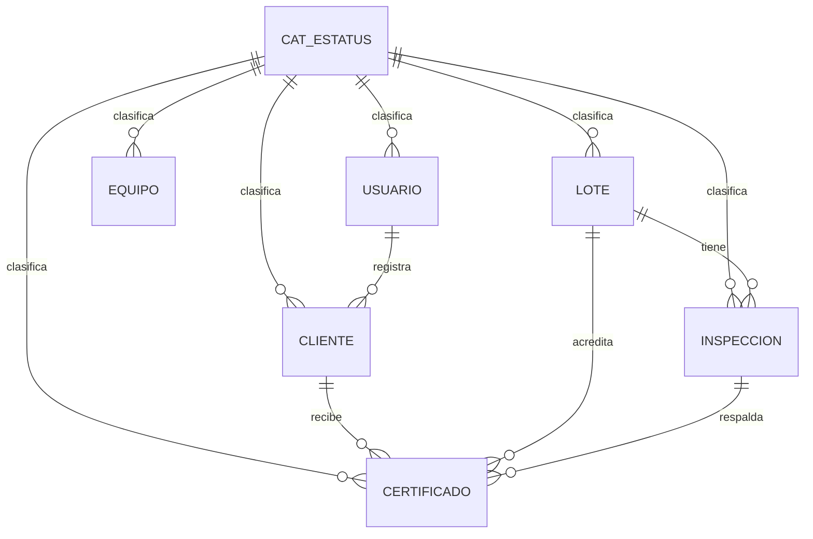
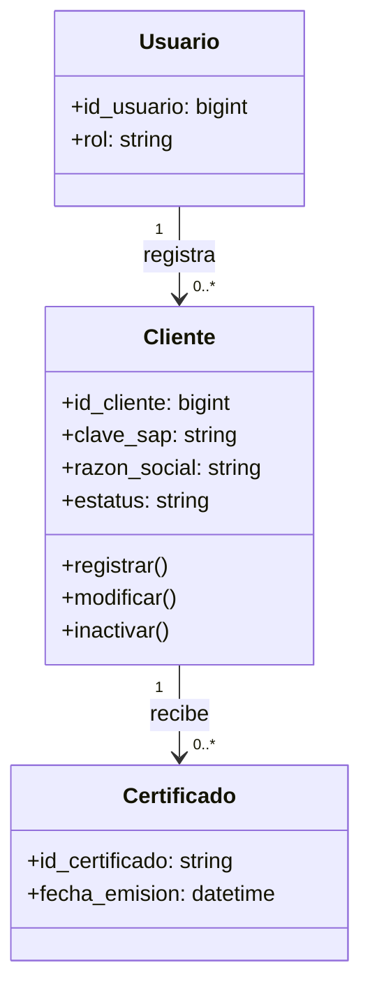

# Proyecto aplicativo — Control de Laboratorio de Calidad de Harina de Trigo
## AVANCE PROPIO 0.1 — continuación del documento PA_IS.pdf

### Alcance implementado (C.1)
Se creó desde cero una aplicación de demostración para el módulo de **Clientes**, con frontend web propio y backend en Node.js 18+. Permite alta, consulta, búsqueda, modificación, inactivación y reactivación. Los datos persisten en `clientes.json`. No se requiere instalar paquetes externos ni usar el código del GitHub de referencia.

### B.1 Caso de uso detallado — UC-02 Gestionar clientes
- Actor: Usuario de transacción.
- Objetivo: registrar, consultar, modificar e inactivar clientes asociados a certificados.
- Precondiciones: usuario autorizado; el registro debe usar clave SAP no repetida. **Nota:** autenticación y roles aún no están implementados en el prototipo.
- Flujo: 1) Entrar a Clientes. 2) Pulsar Nuevo cliente. 3) Capturar clave SAP y razón social, junto con datos opcionales. 4) Validar longitud, correo y RFC. 5) Guardar. 6) Consultar el nuevo registro en el directorio. 7) Modificarlo o inactivarlo si procede.
- Alternos: clave SAP repetida → mensaje de error 409; falta dato obligatorio → 400; cliente inexistente → 404.
- Postcondición: registro persistido; en la baja lógica cambia de ACT a INA, sin eliminar historial.

### B.2 Modelo de datos
El diseño objetivo está en `02_modelo_bd.sql` y contempla catálogo de estatus y las tablas usuario, cliente, equipo, lote, inspeccion y certificado. Es una **propuesta de continuación** basada en la nomenclatura y las reglas del PDF, no una migración ya implementada.

**Diccionario de datos — CLIENTE:**
|Campo|Tipo|Llave|Nulo|Descripción|
|---|---|---|---|---|
|id_cliente|BIGINT|PK|No|Identificador interno|
|clave_sap|VARCHAR(10)|Única|No|Clave de SAP ByD|
|razon_social|VARCHAR(150)|—|No|Nombre fiscal|
|rfc|VARCHAR(13)|—|Sí|RFC|
|domicilio_entrega|VARCHAR(250)|—|Sí|Dirección de entrega|
|contacto_nombre|VARCHAR(100)|—|Sí|Contacto|
|contacto_correo|VARCHAR(100)|—|Sí|Correo destinatario|
|requiere_certificado|BOOLEAN|—|No|Si requiere certificado|
|id_estatus|CHAR(3)|FK|No|CAT_ESTATUS|
|fecha_alta|TIMESTAMP|—|No|Fecha de registro|
|id_usuario_alta|BIGINT|FK|Sí|Usuario que dio de alta|

**Modelo ER parcial:**

**Diagrama de clases lógico parcial:**

### B.3 Interfaces
**Árbol de jerarquía previsto:** Inicio de sesión → Panel principal → Clientes (Alta, Consulta, Modificación, Inactivación) / Equipos / Lotes / Inspecciones / Certificados / Reportes.

**Pantalla implementada:** `public/index.html`: cabecera, menú lateral, contadores, buscador, directorio, formulario modal y acciones de editar/inactivar. Los demás menús se muestran identificados como **próximos**, no operativos.

### B.4 Diseño técnico (programa Clientes)
|Elemento|Detalle|
|---|---|
|Entrada|Clave SAP, razón social, RFC, domicilio, contacto, correo, requiere certificado|
|Proceso|Validación de campos, unicidad SAP, almacenamiento, modificación, estado ACT/INA|
|Salida|Listado, contadores, mensajes de validación, registro creado/actualizado|
|Frontend|`public/index.html`: HTML, CSS, JavaScript|
|Backend|`server.js`: API HTTP GET/POST/PUT/PATCH|
|Persistencia actual|Archivo JSON local autogenerado|
|Persistencia objetivo|PostgreSQL, según `02_modelo_bd.sql`|

### Pendientes para siguientes avances
Implementar inicio de sesión real, permisos, PostgreSQL, bitácora, equipos, lotes, inspecciones, parámetros de referencia, certificados PDF, envíos y reportes. Validar con el profesor el diseño de secuencias de inspección que superen la letra Z y la separación de valores de referencia generales vs. por cliente.
