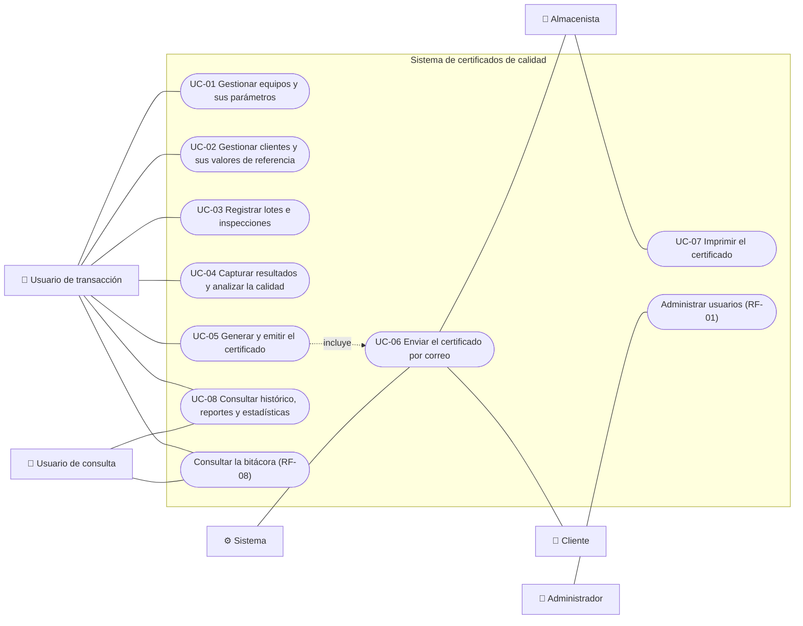
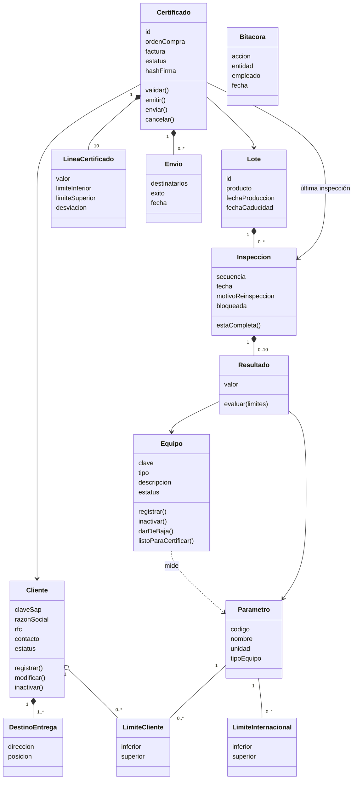
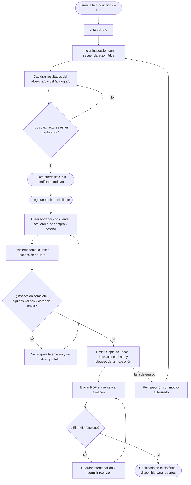
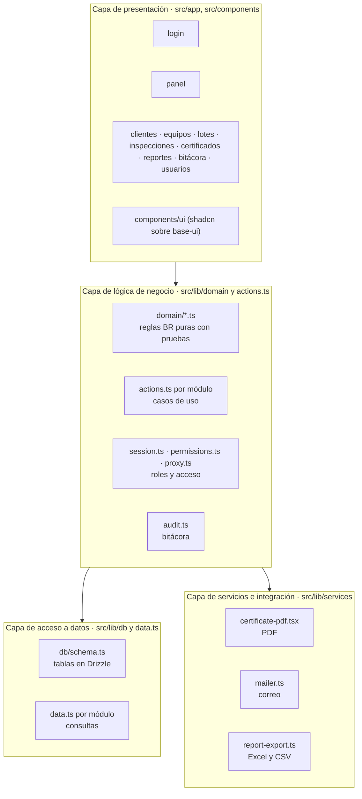
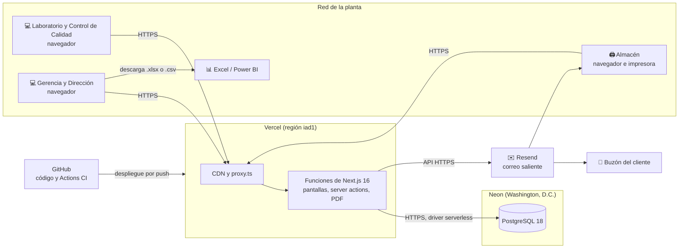

# Diseño arquitectónico de Harinas Elizondo

Este documento explica la arquitectura del sistema de control de laboratorio que emite certificados de calidad de harina de trigo. Sigue el modelo de vistas 4+1, así que tiene una vista de escenarios con los casos de uso y luego las vistas lógica, de proceso, de desarrollo y física. Al final están las características de calidad con su ficha técnica y los patrones arquitectónicos que usa el código.

La primera versión de esta arquitectura fue la entrega 1 del equipo (abril de 2026). Aquí se reescribe con lo que realmente se construyó, y cuando algo cambió respecto a esa entrega se dice qué cambió y por qué. Los identificadores RF, UC, BR, D y Q son los mismos de `docs/llm/requirements.md` y `docs/llm/decisions.md`, y también aparecen en los comentarios del código y en los nombres de las pruebas.

Documentos relacionados

| Documento | Qué tiene |
| --- | --- |
| [Diseño de la base de datos](diseno-base-datos-es.md) | Diagrama entidad relación, diccionario de datos y reglas de integridad |
| [Especificación técnica](especificacion-tecnica-es.md) | Diseño técnico completo con pantallas, SQL, comportamiento, interfaces, calidad de servicio e instalación |
| [Proceso de desarrollo](proceso-desarrollo-es.md) | Cómo se organizó el equipo, el flujo de trabajo y las herramientas |
| [Guías de pruebas](testing/README.md) | Un guion por tipo de prueba con sus resultados |

## Contexto del problema

Cuando termina la producción de un lote, el laboratorio analiza una muestra con dos equipos, el alveógrafo y el farinógrafo, y registra los resultados como una inspección. Después, cuando un cliente hace un pedido que necesita certificado, el laboratorio elige el lote, toma su última inspección completa, compara cada valor con los límites del cliente o con los internacionales, y emite un certificado en PDF que muestra cualquier desviación. El PDF se envía al contacto del cliente y al almacén, que lo imprime y lo anexa a la factura.

Antes esto se hacía con hojas de cálculo y un editor de PDF, así que era lento y permitía "ajustar" inspecciones viejas para que le quedaran a un cliente. La arquitectura existe para quitar ese riesgo, por eso cada decisión importante protege la integridad de los resultados y deja rastro de quién hizo qué.

## Vista de escenarios (casos de uso)

Los actores son cinco. El usuario de transacción es el personal de laboratorio y de Control de Calidad, que da de alta y emite. El usuario de consulta es la gerencia y la dirección, que solo ve reportes, histórico y bitácora. El administrador crea las cuentas de los otros dos. El almacenista recibe e imprime el certificado, y el cliente lo recibe por correo. El sistema mismo actúa como un sexto actor automático cuando envía correos y escribe la bitácora.

| Caso de uso | Actor principal | Requisito | Qué resuelve |
| --- | --- | --- | --- |
| UC-01 | Transacción | RF-02 | Alta, cambio, inactivación y baja de equipos con clave generada y límites internacionales de sus cinco factores |
| UC-02 | Transacción | RF-03 | Alta, cambio e inactivación de clientes con clave SAP, RFC único, destinos de entrega y valores de referencia propios |
| UC-03 | Transacción | RF-04 | Alta de lotes e inicio de inspecciones con secuencia automática A, B, …, Z, AA |
| UC-04 | Transacción | RF-04 | Captura de los diez factores con vista previa de la desviación |
| UC-05 | Transacción | RF-05 | Borrador, validación, emisión, firma y cancelación del certificado |
| UC-06 | Sistema | RF-06 | Envío del PDF al cliente y al almacén con evidencia de cada intento |
| UC-07 | Almacenista | RF-05 | Descarga e impresión del PDF |
| UC-08 | Consulta | RF-07 | Histórico con filtros, gráficas, estadísticas de calidad y exportación a Excel y Power BI |

Cada caso de uso está detallado con flujo principal, flujos alternos y diagrama de secuencia en la sección Diseño de comportamiento de la [especificación técnica](especificacion-tecnica-es.md).

## Vista lógica

La vista lógica muestra las clases del dominio y cómo se relacionan. Un cliente tiene uno o más destinos de entrega y puede tener límites propios por parámetro. Un equipo mide los parámetros de su tipo. Un lote tiene varias inspecciones, y cada inspección guarda un resultado por parámetro, con el equipo que lo midió. Un certificado se emite para un cliente a partir de un lote y de la última inspección de ese lote, y guarda una copia de cada línea con su límite y su desviación.

La bitácora no se dibuja con flechas porque cualquier clase escribe en ella. Toda alta, cambio, emisión, envío o cancelación deja una fila con el número de empleado y el nombre de quien actuó (BR-AUD-01).

### Cambio respecto a la entrega 1

La entrega 1 proponía una sola entidad Valor de Referencia en la que el cliente especial 999 representaba los valores internacionales. Al construir se separó en dos tablas, `international_limits` y `client_limits` (D-07). Así ningún listado, reporte o conteo tiene que excluir un cliente falso, y no hay riesgo de que una clave SAP real choque con el 999. La regla de negocio no cambió, porque un cliente sin límites propios sigue usando los internacionales (BR-REF-01).

## Vista de proceso

La vista de proceso sigue el flujo de un lote desde que termina su producción hasta que su certificado queda en el histórico. Tiene dos momentos separados, porque el análisis ocurre al producir y el certificado ocurre cuando llega un pedido, que puede ser días después.

Las reglas que gobiernan el flujo son estas.

- La secuencia de inspección la genera el sistema (BR-INS-01). Después de la Z sigue AA, AB y así hasta ZZZ (D-08).
- El certificado usa siempre la última inspección del lote. Si esa inspección está incompleta, el certificado se bloquea aunque exista otra anterior completa (D-27).
- Un valor fuera de rango no bloquea el certificado, solo aparece en la columna de desviación (BR-CER-04).
- Al emitir, la inspección queda bloqueada y ya no se pueden cambiar sus resultados (BR-AUD-03).
- Una nueva inspección después de una completa solo se permite por falla del equipo y con el motivo escrito (D-15).

En el código cada paso es una server action que primero revisa el rol, luego valida con una regla pura del dominio y al final guarda el cambio junto con su fila de bitácora en una sola transacción (`db.batch`).

## Vista de desarrollo

La vista de desarrollo muestra cómo está organizado el código. La entrega 1 propuso cuatro capas, presentación, lógica de negocio, acceso a datos y servicios de integración. El proyecto respeta esas cuatro capas, y en Next.js cada una vive en una carpeta distinta.

| Carpeta | Capa | Qué contiene |
| --- | --- | --- |
| `src/app/(app)/<módulo>/page.tsx` y `_components/` | Presentación | Pantallas en español, una carpeta por módulo |
| `src/components/` | Presentación | Componentes compartidos, navegación por rol, menú móvil |
| `src/lib/domain/` | Lógica de negocio | Reglas puras sin base de datos, por eso se prueban sin infraestructura |
| `src/app/(app)/<módulo>/actions.ts` | Lógica de negocio | Server actions, una por caso de uso, con revisión de rol y bitácora |
| `src/lib/session.ts`, `permissions.ts`, `modules.ts`, `src/proxy.ts` | Lógica de negocio | Seguridad por rol |
| `src/lib/audit.ts` | Lógica de negocio | Escritura de la bitácora |
| `src/lib/db/` y `data.ts` de cada módulo | Acceso a datos | Esquema Drizzle, cliente de Neon y consultas |
| `src/lib/services/` | Servicios e integración | PDF, correo con Resend y exportación |
| `drizzle/` | Acceso a datos | Migraciones SQL numeradas |
| `e2e/`, `src/test/int/`, `*.test.ts` | Pruebas | Pruebas de sistema, de componentes y unitarias |

La regla de dependencias es que una capa solo llama a la de abajo. Las pantallas nunca consultan la base directamente, siempre pasan por `data.ts`, y las reglas del dominio no importan nada de la base ni de Next.js. La entrega 1 pedía "no monolito por tema de mantenimiento", y eso se cumple con módulos separados por carpeta y capas con dependencias en un solo sentido, aunque todo se despliegue como una sola aplicación.

## Vista física

La entrega 1 suponía un servidor de aplicación y una base de datos dentro de la red de la empresa. Al construir se eligió la nube, porque el equipo no tiene un servidor propio y Vercel y Neon dan hospedaje gratuito con despliegues por cada PR (D-01, D-02). Los usuarios siguen entrando desde un navegador, como pedía la entrega 1, pero el servidor y la base ya no viven en la red interna.

| Nodo | Tecnología | Qué hace |
| --- | --- | --- |
| Equipos de los usuarios | Cualquier navegador moderno, también en teléfono | Muestran las pantallas. No necesitan instalar nada |
| Servidor de aplicación | Funciones de Vercel con Next.js 16 | Procesa pantallas, server actions, genera el PDF y llama al correo |
| Base de datos | PostgreSQL en Neon | Guarda clientes, equipos, lotes, inspecciones, certificados, envíos, usuarios y bitácora |
| Servicio de correo | Resend | Envía el PDF al cliente y al almacén |
| Herramientas de análisis | Excel y Power BI | Abren el histórico exportado |
| Repositorio y CI | GitHub y GitHub Actions | Guardan el código, corren pruebas en cada PR y disparan el despliegue |

La producción vive en https://harinas-elizondo.vercel.app. Cada rama tiene además su propia vista previa en Vercel, que el equipo usó para revisar cada PR antes del merge.

## Características de calidad

La entrega 1 definió siete características. Esta tabla dice qué decisión de arquitectura cumple cada una.

| Característica | Decisión de arquitectura que la cumple |
| --- | --- |
| Seguridad | Tres roles (administrador, transacción y consulta). Cada server action y cada lectura llama a `requireRole` antes de tocar datos, así que ocultar un botón nunca es la única protección. Registro público apagado (D-14) |
| Confiabilidad | Las reglas de emisión son funciones puras con pruebas nombradas por su BR. El certificado no se emite sin inspección completa, equipos válidos y datos de envío (BR-CER-05) |
| Integridad de la información | Las líneas del certificado son una copia (D-10), la inspección se bloquea al emitir (BR-AUD-03), el certificado lleva un hash SHA-256 de su contenido (D-26) y nada se borra, solo se inactiva o se cancela con motivo |
| Disponibilidad | Hospedaje administrado en Vercel y Neon, sin servidor propio que mantener |
| Usabilidad | Todo en español, errores por campo sin perder lo escrito, avisos por acción, menú filtrado por rol y menú móvil |
| Mantenibilidad | Una carpeta por módulo, capas con dependencias en un solo sentido, reglas de negocio aisladas, CI en cada PR |
| Trazabilidad | Bitácora con número de empleado y nombre en cada acción, pantalla de solo lectura para ambos roles y exportación auditada |

## Ficha técnica

La ficha técnica de la entrega 1 definía un indicador y un criterio por característica. Aquí se agrega cómo se mide hoy y dónde está la evidencia.

| Característica | Indicador | Criterio de evaluación | Cómo se mide | Evidencia |
| --- | --- | --- | --- | --- |
| Seguridad | Acceso restringido por perfil | Solo usuarios autorizados entran a cada función | Pruebas de permisos por rol y rutas directas | `src/lib/permissions.test.ts`, `e2e/roles.spec.ts`, PA-06 |
| Confiabilidad | Validación previa a la emisión | No se emite un certificado con información incompleta | Pruebas de BR-CER-01 a BR-CER-05 | `src/lib/domain/certificate.test.ts`, PC y PI de certificados |
| Integridad de la información | Bitácora y control de cambios | Ningún dato cambia sin registro, y una inspección certificada no cambia | Pruebas de bloqueo y de bitácora | `src/lib/audit.test.ts`, `src/app/(app)/certificados/actions.int.test.ts` |
| Disponibilidad | Acceso en horario operativo | El sistema está disponible durante la operación normal | Estado de despliegues en Vercel | Panel de Vercel del proyecto |
| Usabilidad | Interfaz clara y navegación sencilla | El usuario hace sus tareas sin errores frecuentes | Pruebas de aceptación con tareas, tiempos y errores | `docs/testing/pruebas-aceptacion-es.md` |
| Mantenibilidad | Arquitectura modular | Un cambio no afecta otras funciones | Suite completa en CI en cada PR | `.github/workflows/ci.yml`, `docs/testing/pruebas-regresion-es.md` |
| Trazabilidad | Registro de acciones por usuario | Todas las operaciones quedan en la bitácora | Pantalla de Bitácora y pruebas de componentes | `/bitacora`, PC de bitácora |

## Patrones arquitectónicos

- **Arquitectura en capas.** Presentación, lógica de negocio, acceso a datos y servicios, con dependencias hacia abajo. Es el patrón que pidió la entrega 1 y el que más ayuda a la mantenibilidad.
- **Cliente servidor sobre la web.** El navegador solo muestra pantallas, y toda regla corre en el servidor. Ningún cálculo que importe para el certificado se hace en el navegador.
- **Modelo vista controlador adaptado a Next.js.** Las pantallas (`page.tsx`) son la vista, las server actions (`actions.ts`) hacen de controlador y el esquema con sus consultas (`schema.ts`, `data.ts`) es el modelo.
- **Repositorio.** Cada módulo concentra sus consultas en `data.ts`, así que las pantallas no escriben SQL.
- **Núcleo funcional, capa imperativa.** Las reglas del negocio son funciones puras en `src/lib/domain/`, y la base, el correo y el PDF quedan en el borde. Por eso hay más de cien pruebas unitarias que corren en menos de un segundo.
- **Registro de auditoría append only.** La bitácora solo recibe inserciones, nunca cambios ni borrados.
