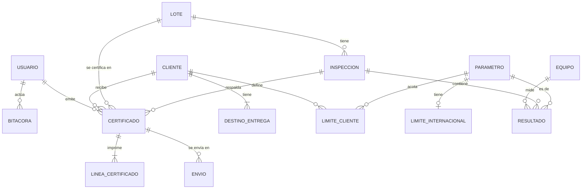
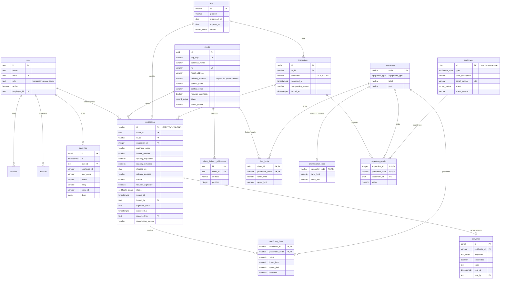

# Diseño de la base de datos de Harinas Elizondo

Este documento explica cómo se diseñó la base de datos del sistema de certificados de calidad. Tiene primero un modelo conceptual con solo las entidades y sus relaciones, luego el diagrama entidad relación completo con columnas y llaves, y al final las decisiones de diseño que explican por qué el modelo quedó así.

El esquema vive en `src/lib/db/schema.ts` (tablas del negocio) y `src/lib/db/auth-schema.ts` (tablas de Better Auth). Las migraciones SQL que crean la base están en `drizzle/`. El diccionario de datos con el tipo y la descripción de cada columna está en la sección Diseño de datos de la [especificación técnica](especificacion-tecnica-es.md), y la arquitectura general en [Diseño arquitectónico](diseno-arquitectonico-es.md).

## Motor y convenciones

| Tema | Decisión |
| --- | --- |
| Motor | PostgreSQL 18 administrado por Neon, conectado por HTTP con `@neondatabase/serverless` (D-02) |
| Acceso desde el código | Drizzle ORM, con el esquema escrito en TypeScript, así que las consultas están tipadas |
| Nombres | Tablas y columnas en inglés y en `snake_case` (D-06). Drizzle traduce `sapKey` a `sap_key` |
| Migraciones | `pnpm db:generate` crea el SQL a partir del esquema y `pnpm db:migrate` lo aplica. Cinco migraciones, de `0000` a `0004` |
| Auditoría de filas | Casi todas las tablas de negocio guardan `created_at` y `created_by` |

## Modelo conceptual

El modelo conceptual muestra solo las entidades y cómo se relacionan, sin columnas, para leerlo de un vistazo.

Se lee así. Un lote tiene cero o más inspecciones, y cada inspección contiene hasta diez resultados, uno por parámetro, cada uno medido con un equipo. Un certificado une a un cliente con un lote y con la inspección que lo respalda, imprime diez líneas y puede tener varios intentos de envío. Los límites internacionales son uno por parámetro, y un cliente puede tener límites propios solo para los parámetros que le importan.

## Diagrama entidad relación

El diagrama muestra las columnas principales de cada tabla y todas las llaves. PK es llave primaria, FK es llave foránea y UK es restricción única.

Casi todas las tablas de negocio tienen además `created_at` y `created_by` (o `updated_at` y `updated_by` en los límites), con `created_by` como llave foránea a `user.id`. El diagrama las omite para que se lea mejor.

## Decisiones de diseño

### Dos tablas de límites en lugar de un cliente especial

La entrega 1 guardaba los límites internacionales como si fueran de un cliente especial con id 999. El diseño final usa `international_limits`, con una fila por parámetro, y `client_limits`, con una fila por cliente y parámetro (D-07). Así ningún listado ni reporte tiene que excluir un cliente falso, y una clave SAP real nunca puede chocar con el 999. Cuando un cliente no tiene límite propio para un parámetro, la aplicación usa el internacional (BR-REF-01). Un límite propio puede ser más estrecho que el internacional pero nunca más amplio (D-23).

### Un resultado por fila

`inspection_results` guarda un resultado por inspección y parámetro, con el equipo que lo midió, en lugar de diez columnas en `inspections`. Eso permite guardar capturas parciales, saber qué equipo midió cada valor y validar con una sola consulta si la inspección está completa (BR-INS-03). Las dos máquinas viven en la misma inspección porque el certificado necesita ambas (D-09).

### El certificado guarda una copia

`certificate_lines` copia el valor, los límites y la desviación de cada parámetro al momento de emitir (D-10), y `certificates.delivery_address` copia el destino elegido (D-24). Si después cambian los límites del cliente o su dirección, un certificado emitido sigue diciendo exactamente lo mismo que el PDF que recibió el cliente. Por eso el histórico y los reportes leen de la copia y no de los límites vigentes.

### Integridad del certificado

Al emitir, la aplicación calcula un SHA-256 del contenido y lo guarda en `signature_hash` (D-26). El PDF lo imprime y la pantalla del certificado lo vuelve a calcular para avisar si algo cambió. En la misma transacción la inspección usada recibe `locked_at`, y desde ese momento sus resultados no se pueden editar (BR-AUD-03).

### Nada se borra

Clientes, equipos y lotes usan el enum `record_status` (active, inactive, retired) con un motivo. Los certificados emitidos se cancelan con fecha, usuario y motivo, y nunca se eliminan (D-25). Todas las llaves foráneas usan `ON DELETE no action`, así que la base misma impide borrar algo que otro registro usa. Las únicas excepciones son `session` y `account`, que se borran en cascada con su usuario.

### Bitácora que sobrevive a los cambios

`audit_log` copia el número de empleado y el nombre de quien actuó, además de la llave a `user`, para que la fila siga diciendo quién fue aunque el usuario cambie de nombre o se desactive (RF-01, RF-08). La tabla solo recibe inserciones.

### Normalización

El modelo está en tercera forma normal salvo en dos puntos hechos a propósito. Las líneas del certificado repiten valores y límites para conservar la historia (D-10), y la bitácora repite el nombre y el número de empleado para que no dependa del estado actual del usuario. `clients.delivery_address` es un espejo temporal del primer destino que se conserva por compatibilidad con los registros anteriores a `client_delivery_addresses` (D-22).

### Llaves

- Llaves naturales donde el negocio ya tiene un identificador legible. El lote usa su número, el equipo su clave aleatoria de 8 caracteres (BR-EQP-01), el certificado su folio `CER-AAAA-NNNNNN` (D-17) y el parámetro su código.
- Llaves sustitutas donde no lo hay. Clientes usa uuid, y las inspecciones, envíos y bitácora usan serial.
- Llaves compuestas en las tablas de detalle, que son `client_limits`, `inspection_results` y `certificate_lines`. La de `certificate_lines` además impide emitir dos veces el mismo certificado.

### Concurrencia

El driver HTTP de Neon no tiene transacciones interactivas. Cada cambio que debe guardarse junto con su fila de bitácora se manda con `db.batch([...])`, que Neon ejecuta como una sola transacción. Las carreras entre dos usuarios las decide la base con restricciones únicas, por ejemplo un RFC repetido, la misma secuencia de inspección o el mismo folio, y la aplicación traduce el error 23505 a un mensaje en español.

## Más detalle

| Tema | Dónde |
| --- | --- |
| Diccionario de datos columna por columna | Sección Diseño de datos de la [especificación técnica](especificacion-tecnica-es.md) |
| Migraciones, consultas clave e índices | Secciones Diseño SQL y Diseño de la base de datos de la [especificación técnica](especificacion-tecnica-es.md) |
| Esquema fuente | `src/lib/db/schema.ts`, `src/lib/db/auth-schema.ts` |
| Migraciones SQL | `drizzle/0000_married_turbo.sql` a `drizzle/0004_user_access.sql` |
| Datos de demostración | `scripts/seed.ts` |
