# Proceso de desarrollo de Harinas Elizondo

Este documento cuenta cómo construimos el sistema, desde el diseño de la entrega 1 hasta la aplicación en producción. Explica la metodología, el flujo de trabajo con Git, las herramientas, las convenciones que usamos para que el código fuera trazable a los requisitos y cómo probamos cada parte. El qué se construyó está en [Diseño arquitectónico](diseno-arquitectonico-es.md), [Diseño de la base de datos](diseno-base-datos-es.md) y la [especificación técnica](especificacion-tecnica-es.md).

## Metodología

Trabajamos de forma incremental, un módulo a la vez, en el orden en que los datos se necesitan. Primero la base técnica (proyecto, base de datos, sesión y roles), después los catálogos (clientes y equipos), luego la operación del laboratorio (lotes e inspecciones), después el certificado, que usa todo lo anterior, y al final los reportes, la bitácora, las pruebas y la documentación.

Cada incremento fue un pull request pequeño con su requisito, sus pruebas y su vista previa en Vercel, así que cada módulo se podía revisar y probar solo antes de integrarlo. Las dudas de negocio que surgían al programar no se resolvían en silencio. Se anotaban como pregunta abierta en `docs/llm/decisions.md`, se discutían con el equipo o con el profesor, y la respuesta quedaba como decisión con un id (D-01 a D-27).

```mermaid
flowchart LR
  E1["Entrega 1<br/>arquitectura 4+1<br/>abril 2026"] --> E2["Entrega 2<br/>diseño técnico<br/>septiembre 2026"]
  E2 --> Base["Base técnica<br/>Next.js, Neon, sesión<br/>22 oct y 4 nov"]
  Base --> Cat["Clientes y Equipos<br/>4 nov"]
  Cat --> Lab["Lotes e Inspecciones<br/>4 y 5 nov"]
  Lab --> Cer["Certificados<br/>11 nov"]
  Cer --> Rep["Reportes, Bitácora,<br/>Usuarios, menú móvil<br/>11 y 12 nov"]
  Rep --> QA["Pruebas por tipo,<br/>guías y especificación<br/>11 y 12 nov"]
  QA --> Fin["Correo real, revisión<br/>del profesor<br/>15 y 16 nov"]
```

## Cronología

| Fecha | Qué pasó | PR |
| --- | --- | --- |
| 2026-04-17 | Documento de arquitectura del equipo (entrega 1) | Fuera del repositorio |
| 2026-10-21 | Borrador de diseño técnico con el caso de uso de Clientes y un prototipo en Node | Commits iniciales |
| 2026-10-22 | Se elige la pila (D-01 a D-21), se crea el proyecto Next.js con esquema, autenticación, reglas del dominio con pruebas y documentación para agentes | #1 |
| 2026-11-04 | Clientes, sesión con roles, bitácora y Equipos. Correcciones de la primera revisión del profesor (RFC único, domicilio fiscal, varios destinos) | #1, #2, #3, #6 |
| 2026-11-05 | Lotes e Inspecciones con secuencia automática y vista previa de desviaciones | #4 |
| 2026-11-11 | Certificados con PDF, hash y cancelación, y administración de usuarios | #28, #30 |
| 2026-11-12 | Reportes, Bitácora, menú móvil, identidad visual, CI, pruebas de componentes y de sistema, guías de prueba y especificación técnica | #29, #31, #33 a #40 |
| 2026-11-15 y 16 | Envío real de correo con Resend y aviso de buzón de prueba | #41, #44, #45 |
| Después del 11 de noviembre | Notas de la presentación de avances. Estadísticas de calidad de la producción y documentos de arquitectura, de base de datos y de este proceso | Este cambio |

## Organización del equipo

Cada integrante tomó uno o más módulos completos, de la pantalla a la base, para que nadie dependiera de otro a mitad de un módulo. La tabla usa los usuarios públicos de GitHub.

| Módulo o pieza | Autor del PR |
| --- | --- |
| Clientes (UC-02) y sus correcciones | ValleryR |
| Sesión, roles, bitácora base y Equipos (UC-01) | Nath554488 |
| Lotes e Inspecciones (UC-03, UC-04) | Nath554488 |
| Certificados (UC-05, UC-06, UC-07) | AlanPR27 |
| Administración de usuarios e identidad visual | ValleryR |
| Reportes, primera versión (UC-08) | laxmxn |
| Base técnica, Reportes complementarios, Bitácora, menú móvil, CI, pruebas, guías, especificación, correo | Freddy-Nader |

## Flujo de trabajo con Git

- El repositorio del equipo es https://github.com/ValleryR/harinas-elizondo y su rama `main` siempre debe pasar las verificaciones.
- Cada cambio nace en una rama con prefijo por tipo (`feat/`, `fix/`, `docs/`, `test/`, `ci/`) y llega a `main` por pull request. Nadie empuja directo a `main`.
- Los mensajes de commit siguen Conventional Commits y citan el requisito, por ejemplo `feat(certificados): send certificate emails with Resend (RF-06, D-13)`.
- Los merges a `main` usan merge commit, así la historia muestra qué PR trajo cada cambio.
- Cuando dos PR tocaban el mismo archivo de estado, el segundo se actualizaba con `main` antes del merge, nunca con force push sobre una rama compartida.

## Herramientas

| Herramienta | Para qué la usamos |
| --- | --- |
| GitHub | Código, issues para repartir el trabajo y pull requests para revisar |
| GitHub Actions | CI en cada PR y en cada push a `main`. Typecheck, lint, pruebas unitarias, de componentes, de sistema y build |
| Vercel | Producción en https://harinas-elizondo.vercel.app y una vista previa por rama |
| Neon | PostgreSQL administrado, conectado a Vercel desde su Marketplace |
| Resend | Envío del certificado por correo |
| Drizzle Kit | Generar y aplicar las migraciones |
| Vitest y Playwright | Pruebas unitarias, de componentes, integrales y de sistema |
| pnpm | Paquetes, con la versión fija en `package.json` |

## Convenciones

- **Trazabilidad.** Cada requisito, caso de uso, regla de negocio y decisión tiene un id (RF, UC, BR, D, Q) definido en `docs/llm/requirements.md` y `docs/llm/decisions.md`. Esos ids aparecen en los comentarios del código, en los nombres de las pruebas y en los mensajes de commit, así que de cualquier línea se puede llegar al requisito que la pide.
- **Idioma.** El código, los nombres de tablas y los commits están en inglés. Todo lo que ve el usuario está en español, desde las pantallas y los errores hasta los correos y el PDF. Los documentos para el profesor están en español.
- **Reglas del negocio aisladas.** Cada regla es una función pura en `src/lib/domain/`, sin base de datos, con una prueba nombrada por su BR. Por ejemplo `certificate.test.ts` prueba BR-CER-01 a BR-CER-05.
- **Seguridad en el servidor.** Cada server action y cada lectura revisan el rol con `requireRole`. Esconder un botón nunca es la única protección.
- **Bitácora en la misma transacción.** Cada cambio guarda su fila de `audit_log` junto con el dato, con `db.batch`.
- **Documentación viva.** `docs/llm/status.md` y `docs/llm/decisions.md` se actualizan en el mismo PR que mueve el trabajo.

## Cómo probamos

Seguimos la pirámide de pruebas. Muchas pruebas rápidas abajo y pocas lentas arriba.

| Nivel | Qué prueba | Herramienta | Guía |
| --- | --- | --- | --- |
| Unitarias | Reglas puras del dominio y validaciones | Vitest | [Pruebas unitarias](testing/pruebas-unitarias-es.md) |
| Componentes | Server actions contra un PostgreSQL real | Vitest con Postgres en Docker | [Pruebas de componentes](testing/pruebas-componentes-es.md) |
| Integrales | Flujos de varias pantallas | Playwright | [Pruebas integrales](testing/pruebas-integrales-es.md) |
| Sistema | La aplicación completa por rol | Playwright y revisión manual | [Pruebas de sistema](testing/pruebas-sistema-es.md) |
| Regresión | Toda la suite en cada PR | GitHub Actions | [Pruebas de regresión](testing/pruebas-regresion-es.md) |
| Aceptación | Tareas reales con usuarios externos | Guion con moderador | [Pruebas de aceptación](testing/pruebas-aceptacion-es.md) |

Antes de abrir un PR se corren `pnpm typecheck`, `pnpm lint`, `pnpm test` y `pnpm build`, y CI repite lo mismo. Las pruebas que usan base de datos solo aceptan una base local cuyo nombre termina en `_test`, para que ninguna prueba toque la base de producción.

## Uso de asistentes de IA

Usamos asistentes de programación con IA para generar código, pruebas y documentos. Para que trabajaran con las mismas reglas que el equipo, el repositorio tiene `AGENTS.md` y la carpeta `docs/llm/` con el contexto del curso, los requisitos, la arquitectura, las decisiones y el estado. Todo lo que generaron pasó por pull request, por CI y por la revisión de un integrante antes del merge.

## Retroalimentación de la presentación de avances

En la presentación del 11 de noviembre el profesor pidió estas mejoras, y así se atendieron.

| Nota del profesor | Cómo se atendió |
| --- | --- |
| Graficar estadísticas | Reportes tiene gráficas de certificados (Pareto de desviaciones y tendencia mensual) y ahora una sección de calidad de la producción |
| Qué te interesaría saber para conocer la calidad de la harina que produces | Sección Calidad de la producción en Reportes. Porcentaje de lotes dentro de especificación, gráfica de control por factor con sus límites, porcentaje en especificación por factor, promedio, desviación estándar, rango, Cpk y reinspecciones |
| Documentación del diseño arquitectónico y técnico | [Diseño arquitectónico](diseno-arquitectonico-es.md) con las vistas 4+1 y la [especificación técnica](especificacion-tecnica-es.md) |
| Carpeta de docs | `docs/` ordenada, con un índice en [docs/README-es.md](README-es.md) |
| Documentar el diseño y cómo lo desarrollamos | Este documento |
| Diagrama ER y diseño de la base de datos | [Diseño de la base de datos](diseno-base-datos-es.md) |
